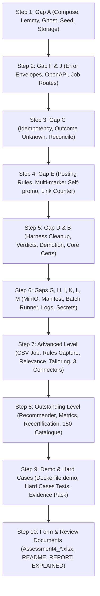

# IncuBrix Engineering Assessment 4 - Gap Analysis & Execution Plan

This gap analysis reviews the existing IncuBrix Long-Tail Destination Network codebase against the official brief (`Problem Statements/IncuBrix_Assessment_4_Distribution_Long_Tail_Destination_Network_Brief.pdf`), the current submission workbook (`Problem Statements/Assessment4_BalaMurugan.xlsx`), and the reviewer audit findings.

Every Must-have, Level item, and Integration Standard requirement is evaluated for:
1. **Existing Code Capabilities**: What the current implementation already achieves.
2. **Current Deficiencies / Gaps**: What is missing, incomplete, or falsely claimed.
3. **Target Files**: Which exact modules will be updated or created (no rewrites; additive, surgical fixes only).
4. **Target Phase & Action**: The planned implementation step.

---

## 1. Must-Haves (Pass / Fail)

| # | Must-Have Requirement | Existing Implementation | Identified Gaps | Target Files to Modify |
|---|---|---|---|---|
| **MH-1** | **Exact connector contract**: All methods (`validate`, `publish`, `get_status`, `delete`, `fetch_metrics`, `refresh_auth`, `build_assist_pack`), YAML manifests, and error codes in Appendix A. | Base abstract class in `app/connectors/base.py`, 6 manifests in `connectors/manifests/`, error taxonomy in `app/rules/errors.py`. 28 unit tests pass. | Manifest format in Appendix A requires `surfaces: - key: topic, content_types: [...], spec: {...}` and `rate_limits: per_connection: {requests, per_seconds}`. Current manifests use non-standard field names (`format_limits`, `requests_per_minute`). Need Appendix A compliance while preserving backwards compatibility. | `app/schemas/connector.py`, `connectors/manifests/*.yaml`, `app/connectors/base.py`, `tests/unit/test_connector_contract.py` |
| **MH-2** | **Six Core connectors certified**: Discourse, Lemmy, Dev.to, Ghost, generic signed webhook (HMAC), and assisted connector with ready-to-post pack. | Basic connectors exist in `app/connectors/`. Mock endpoints exist in `mock_platforms/server.py`. | Certification was run only against mocks, not against real local Lemmy and Ghost instances. Assisted connector in `app/certification/harness.py` was short-circuited without building a real ready-to-post pack. Evidence files were not clearly partitioned into "real local instance" vs "mock". | `docker-compose.yml`, `app/connectors/assisted.py`, `app/certification/harness.py`, `tests/integration/test_certification.py`, `outputs/evidence/` |
| **MH-3** | **Configuration, not code**: Adding another forum, community, or site is one catalogue row with no code change. | Database model `DestinationModel` stores `url`, `platform_key`, `connector_key`, `instance_config`. | Need explicit integration test proving adding a 2nd Discourse instance and a 2nd Lemmy community via API/CSV works without modifying any connector code. | `tests/integration/test_destinations_api.py`, `app/models/destination.py` |
| **MH-4** | **Rules checked before every post**: Frequency cap, self-promotion policy, link policy, AI-content disclosure, automation allowed. Blocked or rescheduled with clear reason. | `app/rules/engine.py` checks basic rules before publication in `app/jobs/manager.py`. | (1) Direct publish and connector contract routes bypass `rules_engine.check_rules`. (2) Frequency cap only checks 24h count; needs configurable period (e.g. N per period). (3) Self-promotion check is a tiny keyword list; needs multi-marker heuristic (CTAs, discounts, affiliate words, "sign up"). (4) Link counter misses bare domains, www, and HTML `<a href>`. (5) Destination with missing rules must fail closed. (6) Job manager erroneously sets `last_certified_at` on normal publish. | `app/rules/engine.py`, `app/api/connector_routes.py`, `app/api/destinations.py`, `app/jobs/manager.py`, `tests/unit/test_rules_engine.py` |
| **MH-5** | **Never spam, never cheat**: Test posts only to test instances / agreed sandboxes, deleted within 10 minutes. Respect 429 reset time. | Certification harness attempts probe post, visibility check, and deletion. Backoff logic in `app/rules/backoff.py`. | If a step fails post-publish in `CertificationHarness`, the probe post is abandoned and not deleted! Needs automatic cleanup reconciliation by test token, retrying deletion up to 10 minutes. Never report `deletion_confirmed=True` unless verified by a status read. On 429, wait for reset time (capped). | `app/certification/harness.py`, `app/rules/backoff.py`, `tests/integration/test_certification.py` |
| **MH-6** | **Safe retries**: Same idempotency key never creates a second post, even after timeout. | `app/api/middleware.py` and `app/storage/idempotency_store.py` store SHA-256 hash and response. | (1) On failure or timeout, `IdempotencyStore` marks status `"failed"`, allowing a blind retry that creates a duplicate if the platform processed the post before timing out. Must store `"outcome_unknown"` and run platform reconciliation before retrying. (2) `import-csv` route was exempt from idempotency key. (3) Need end-to-end test where mock creates post then times out, proving retry returns same post and platform has exactly 1 post. | `app/storage/idempotency_store.py`, `app/api/middleware.py`, `app/connectors/*.py`, `mock_platforms/server.py`, `tests/unit/test_idempotency.py` |
| **MH-7** | **Secrets protected & simulation mode**: Tokens never appear in logs or repository; simulation mode with mock platforms runs without real accounts. | Mock platform server in `mock_platforms/server.py`. Logger config in `app/logging_conf.py`. | Need automated secret scanning script (`scripts/secret_scan.py`) that scans codebase, test outputs, and docker logs, asserting 0 tokens/secrets leak. Add log filter to ensure `Authorization` headers and API keys are redacted. | `scripts/secret_scan.py`, `app/logging_conf.py`, `tests/unit/test_secrets_and_simulation.py` |
| **MH-8** | **Local test instances**: `docker compose up` starts service + real local Lemmy + real local Ghost + mock servers + MinIO with 1 command. | `docker-compose.yml` only runs `incubrix-api`, `incubrix-mock`, and MinIO. | Missing official Lemmy (lemmy, lemmy-ui, postgres, pict-rs) and official Ghost (ghost + mysql 8) containers. Missing automated seed container to create Lemmy admin/community and Ghost owner/API key and write credentials to a shared volume. Bind mount of `./incubrix.db` causes directory creation bugs on clean machines. | `docker-compose.yml`, `scripts/seed_local_instances.py`, `Dockerfile.seed`, `app/config.py` |
| **MH-9** | **Integration Standard followed & live demo**: All 10 Integration points followed; demo container configured. | Partial integration points implemented. Basic `Dockerfile`. | Integration points 1-10 have specific gaps (see Section 3). Missing `Dockerfile.demo`, `render.yaml`, token authentication, rate limiting, and `scripts/check_live_demo.py`. | `Dockerfile.demo`, `render.yaml`, `scripts/check_live_demo.py`, `docs/DEPLOY.md` |

---

## 2. Assessment Levels (Core, Advanced, Outstanding)

### Core Level
- **All Must-Haves Pass**: Ensured by completing the 9 items above.
- **Full Certification Run with Stored Evidence**: Certify all 6 Core connectors against real local Lemmy & Ghost, and mock servers for Discourse, Dev.to, Webhook. Build ready-to-post pack for Assisted connector. Save tracked JSON and TXT evidence files.
- **Shared Error Codes Mapping**: Verify every connector maps 401 (`CONNECTION_AUTH_EXPIRED`), 422 (`PLATFORM_CONTENT_REJECTED`), 429 (`PLATFORM_RATE_LIMIT`), 500/503 (`PLATFORM_UNAVAILABLE`), quota exhausted (`PLATFORM_QUOTA_EXHAUSTED`).

### Advanced Level
1. **Catalogue Import Job**:
   - *Existing*: Basic CSV upload in `app/catalogue/csv_importer.py`.
   - *Gaps*: Runs synchronously instead of background job (violating >2s rule); lacks SSRF protection (must block private/link-local IPs unless test flag enabled); lacks full URL normalisation (strip default port, www, trailing slash, tracking params); lacks enrichment (member count, rules link, language, category); lacks benchmark measuring 1,000 rows in <5 minutes with saved output.
   - *Target Files*: `app/catalogue/csv_importer.py`, `app/api/destinations.py`, `app/jobs/manager.py`, `scripts/generate_test_catalogue.py`, `tests/integration/test_catalogue_import_benchmark.py`.
2. **Rules Capture**:
   - *Existing*: Empty stub / manual link in destination model.
   - *Gaps*: Needs an adapter that reads a rules page (HTML/text), proposes 5 rules, verifies VERBATIM quotes as exact substrings of the page, marks proposal as "pending" requiring human confirmation via API, with an offline keyword reader as default, an optional LLM adapter, and a mock adapter for tests.
   - *Target Files*: `app/rules/capture.py`, `app/api/destinations.py`, `tests/unit/test_rules_capture.py`.
3. **Relevance Score (1-5)**:
   - *Existing*: Static default float in model.
   - *Gaps*: Needs algorithmic relevance scoring against IncuBrix audience (AI, video, marketing, SaaS, creators, founders). Destinations with no audience signal must score <= 2. Include clear explanation.
   - *Target Files*: `app/catalogue/relevance.py`, `app/models/destination.py`, `tests/unit/test_relevance_scoring.py`.
4. **Content Tailoring**:
   - *Existing*: Static formatting limits check.
   - *Gaps*: Manifest-driven tailoring engine: discussion framing & closing question for forums, canonical URL for articles, word-boundary truncation (never cutting words in half), platform-specific hashtags/mentions, AI disclosure text never cut off, language mismatch warning.
   - *Target Files*: `app/tailoring/engine.py`, `connectors/manifests/*.yaml`, `tests/unit/test_tailoring.py`.
5. **Three Additional Connectors**:
   - *Gaps*: Need 3 additional connectors implemented to the exact contract:
     1. **Hashnode** (developer blogging platform via GraphQL/REST API)
     2. **Slack** (team/community channels via Webhook / Web API)
     3. **Mailchimp** or **Kit** (newsletter platform, strictly draft campaigns only, never sending to live subscribers)
   - *Target Files*: `app/connectors/hashnode.py`, `app/connectors/slack.py`, `app/connectors/newsletter.py`, `connectors/manifests/hashnode.yaml`, `connectors/manifests/slack.yaml`, `connectors/manifests/newsletter.yaml`, `mock_platforms/server.py`, `tests/unit/test_additional_connectors.py`.

### Outstanding Level
1. **Recommender Engine**:
   - *Gaps*: Given content rendition, rank destinations by audience fit, rule compatibility (exclude demoted & rule-blocked), and historical performance. Create a labelled evaluation set and measure precision@10 against random baseline and simple-score baseline.
   - *Target Files*: `app/recommender/engine.py`, `app/api/destinations.py`, `test-pack/recommender_eval_set.json`, `tests/unit/test_recommender.py`.
2. **Metrics Ingestion**:
   - *Existing*: Basic `fetch_metrics` stub returning 0s.
   - *Gaps*: Implement and verify `fetch_metrics` across at least 3 connectors (Dev.to, Discourse, Lemmy/Ghost) returning normalised schema: `views`, `likes`, `comments`, `shares`, `clicks`.
   - *Target Files*: `app/connectors/devto.py`, `app/connectors/discourse.py`, `app/connectors/lemmy.py`, `app/connectors/ghost.py`, `mock_platforms/server.py`, `tests/unit/test_metrics.py`.
3. **Recertification Scheduler & Alerts**:
   - *Gaps*: Scheduler checking certified destinations before 30-day cap; automatically demoting failing destinations, excluding them from publishing and recommendations, creating alert records (`GET /api/v1/alerts`), and dispatching signed alert webhooks. Test with a mock clock.
   - *Target Files*: `app/certification/scheduler.py`, `app/models/alert.py`, `app/api/alerts.py`, `tests/unit/test_recertification.py`.
4. **Real Catalogue (150 Destinations)**:
   - *Gaps*: Curate 150 real, relevant long-tail destinations (forums, Lemmy communities, Dev.to/Hashnode tags, Ghost blogs, tech newsletters, manual communities) with verbatim rules quotes, relevance scores, and connector keys. Mark all `catalogue_only=True` to prevent accidental posting. Verify each via CSV importer.
   - *Target Files*: `catalogue/real_destinations_150.csv`, `scripts/verify_catalogue.py`, `outputs/catalogue_verification_report.json`.

---

## 3. Integration Standard (20 Marks)

| # | Integration Point | Existing State | Required Fix | Target Files |
|---|---|---|---|---|
| **1** | **One-command start & test** | Partial compose, separate test commands. | Update `docker-compose.yml` to include real Lemmy + Ghost + mock + MinIO + seed. Single test command `pytest` runs all tests with 0 external API keys required. Comprehensive `.env.example`. | `docker-compose.yml`, `.env.example`, `README.md` |
| **2** | **Documented HTTP API** | `openapi.yaml` exported once. | All routes under `/api/v1/` except `/health`, `/ready`, `/docs`, and `/connector/v1/...`. Automated test verifying `openapi.yaml` exactly matches FastAPI OpenAPI schema. | `app/main.py`, `scripts/export_openapi.py`, `tests/integration/test_openapi.py` |
| **3** | **Background jobs** | Jobs table and manager exist. | Any operation >2s (certification, CSV import, batch publish) must return 202 with `job_id`. `GET /api/v1/jobs/{job_id}` returns status, progress (0-100), result links. Optional HMAC-SHA256 signed callback in `X-IncuBrix-Signature`. | `app/api/certification.py`, `app/api/destinations.py`, `app/jobs/manager.py`, `tests/integration/test_jobs.py` |
| **4** | **Safe retries** | Idempotency middleware on POST. | Exempt nothing (include CSV import). On timeout/outcome unknown, reconcile before replay. | `app/api/middleware.py`, `app/storage/idempotency_store.py` |
| **5** | **Clear errors** | Error codes exist in `errors.py`. | Envelope format MUST be `{"error": {"code", "message", "retryable", "details"}}`. Add `UNAUTHORIZED` and `RATE_LIMITED`. Update exception handlers and middleware responses. | `app/rules/errors.py`, `app/api/middleware.py`, `tests/unit/test_error_envelope.py` |
| **6** | **Configuration** | Pydantic settings. | All paths, URLs, limits, and storage keys configurable via environment variables with defaults in `.env.example`. | `app/config.py`, `.env.example` |
| **7** | **Files in, files out** | Local file evidence storage. | Outputs saved to S3-compatible MinIO with download links; local storage fallback. Inputs accept file upload or URL. | `app/storage/evidence.py`, `app/config.py`, `tests/unit/test_storage.py` |
| **8** | **Logs and health** | JSON logging and `/health`. | Ensure log lines include `timestamp`, `level`, `job_id`, and `X-Correlation-Id`. Add `/ready` endpoint with DB/storage checks. Add test validating JSON log schema. | `app/logging_conf.py`, `app/api/health.py`, `tests/unit/test_logging.py` |
| **9** | **Output manifest** | Partial summary in batch runner. | Every publish, certification, and batch result must include complete JSON manifest (service version, connector version, python version, models/providers used, settings, seed, timings, cost estimate, warnings, rights, and `ai_generated` tag). | `app/schemas/manifest.py`, `app/certification/harness.py`, `scripts/batch_runner.py` |
| **10** | **Batch runner** | `scripts/batch_runner.py` existed. | Must be an external HTTP client calling running API (`POST /api/v1/...`). Must not import app in-process. Accepts folder, JSON list, or JSONL. Writes all results to single directory with summary manifest. Default idempotency key = file name + SHA-256 hash. | `scripts/batch_runner.py`, `tests/integration/test_batch_runner.py` |

---

## 4. Sequential Execution Plan (Small Steps with Commits)

1. **Step 1: Gap A & Infrastructure**
   - Update `docker-compose.yml` to start API, Mock server, MinIO, real Lemmy (official lemmy, lemmy-ui, postgres, pict-rs), and real Ghost (ghost + mysql 8).
   - Add automated seeder (`scripts/seed_local_instances.py`) creating Lemmy admin/community and Ghost owner/API key, writing credentials to a mounted volume.
   - Update `app/config.py` to watch/re-read the seed credentials file dynamically.
   - Replace `./incubrix.db` bind mount with named volume or container path.
   - Verify existing 28 tests pass; commit.

2. **Step 2: Gap F & Gap J (Error Envelopes, Routes, OpenAPI)**
   - Standardize all error responses to `{"error": {"code", "message", "retryable", "details"}}`. Add `UNAUTHORIZED` and `RATE_LIMITED` error codes.
   - Ensure all routes are under `/api/v1/` except `/health`, `/ready`, `/docs`, and `/connector/v1/...`.
   - Update `openapi.yaml` and add automated test verifying exact match with running app.
   - Test; commit.

3. **Step 3: Gap C (Idempotency, Unknown Outcome, Reconcile on Retry)**
   - Remove idempotency exemption for CSV import.
   - Add `"outcome_unknown"` state in `IdempotencyStore`.
   - Add `reconcile` method across connectors to query platforms before retrying publication after unknown outcome.
   - Write end-to-end test with simulated platform delay and timeout retry proving 0 duplicates.
   - Test; commit.

4. **Step 4: Gap E (Posting Rules Engine Enhancement)**
   - Enhance rules engine to support frequency caps with arbitrary time windows.
   - Implement multi-marker self-promotion detector (calls to action, discounts, signup, affiliate links).
   - Expand link parser to recognize bare domains, `www.`, and HTML links.
   - Enforce fail-closed policy on missing destination rules.
   - Apply rules checks across direct, job, and connector execution paths. Remove `last_certified_at` update from normal publish.
   - Test; commit.

5. **Step 5: Gap D & Gap B (Certification Harness, Clean Up, Demotion, Core Runs)**
   - Overhaul `CertificationHarness`: always delete probe post on any failure, retry deletion up to 10 minutes, verify deletion with subsequent status read before setting `deletion_confirmed=True`.
   - Implement verdicts: `passed`, `failed` (demote destination and refuse at publish), `inconclusive` (rate limit / auth error).
   - Handle 429 by waiting for reset time (capped).
   - Implement real `build_assist_pack` validation for Assisted connector.
   - Run certification against real Lemmy & Ghost instances and mock servers. Save structured JSON and TXT evidence labeled "real local instance" or "mock".
   - Test; commit.

6. **Step 6: Gaps G, H, I, K, L, M (MinIO, Manifest, Batch Runner, Logs, Secrets)**
   - Implement S3/MinIO upload in `app/storage/evidence.py` with presigned/API download links and local fallback.
   - Add full metadata manifest schema to publish, certification, and batch outputs (versions, models, timings, cost, rights, AI tag).
   - Overhaul `scripts/batch_runner.py` into a standalone HTTP CLI tool calling `/api/v1/` endpoints.
   - Ensure JSON logging has `timestamp`, `level`, `job_id`, `X-Correlation-Id`. Implement `/ready` probe.
   - Implement `scripts/secret_scan.py` and test that secrets/tokens are never logged or committed.
   - Add test demonstrating adding a 2nd Discourse instance and 2nd Lemmy community via pure configuration.
   - Test; commit.

7. **Step 7: Advanced Level Implementation**
   - 1. Catalogue Import: Asynchronous job, SSRF guard, normalisation, deduplication, enrichment, 1,000-row benchmark in <5 minutes.
   - 2. Rules Capture: Adapter proposing 5 rules with verbatim quotes verified against page content; human confirmation workflow.
   - 3. Audience Relevance: 1-5 score algorithm against IncuBrix audience with explanation.
   - 4. Content Tailoring: Manifest-driven title/body tailoring (discussion framing, canonical URLs, word-boundary truncation, hashtags, AI disclosures).
   - 5. Three Additional Connectors: Hashnode, Slack, Mailchimp/Kit (drafts only).
   - Test; commit.

8. **Step 8: Outstanding Level Implementation**
   - 1. Recommender: Rank destinations by fit, reason, rule compatibility; evaluation set with precision@10 benchmark.
   - 2. Metrics: Normalised `fetch_metrics` on at least 3 connectors.
   - 3. Recertification: 30-day scheduler, auto-demotion, alert store and API (`/api/v1/alerts`).
   - 4. Real Catalogue: 150 real, relevant destinations with verbatim rules, relevance scores, marked `catalogue_only`.
   - Test; commit.

9. **Step 9: Demo Packaging & Hard Case Verification**
   - Build `Dockerfile.demo`, `render.yaml`, token authentication, rate limiting, and failure switches.
   - Create `scripts/check_live_demo.py`.
   - Run all Hard Case scenarios and save evidence under `test-pack/` with `INDEX.md`.
   - Test; commit.

10. **Step 10: Submission Documentation & Workbook**
    - Create `docs/EXPLAINED.md` with candidate analogies and 15 quiz questions.
    - Create `docs/DEPLOY.md`.
    - Update `README.md`, `REPORT.md`, `SOURCES.md`, `AI_USE.md`, and `docs/EVIDENCE_LOG.md`.
    - Update `Problem Statements/Assessment4_BalaMurugan.xlsx` with verified, honest data and valid file links.
    - Perform fresh clone verification and git status check.
